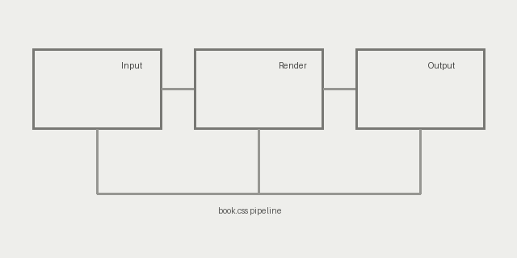

# Chapter One: Setting the Page

A document that is meant to be *read* asks for different choices than one that is
meant to be scanned. The line should be short enough that the eye returns to the
same place without effort, the type should be quiet enough to disappear behind
the meaning, and the colour should carry no message of its own. This chapter
walks through those choices one at a time, using a single stylesheet —
`book.css` — as its running example.

The measure of a comfortable reading line sits near sixty-five to seventy
characters, which is why the column below is capped at forty rem rather than
spanning the whole window. Text is justified with hyphenation so that the ragged
edge stays gentle, the way it does on a printed page.

## Rules and Rhythm

Sections are separated by hairlines rather than boxes. Headings are set in the
body face at a restrained size: a chapter title is centred over a short rule,
while section headings stay flush left above a full-measure rule. Neither uses
colour to announce itself — only weight, size, and position.

Inline emphasis is deliberately plain. Here is *emphasis*, **strong emphasis**,
an inline `code` sample, a [named link](https://example.com), a keyboard
sequence such as <kbd>Ctrl</kbd> + <kbd>S</kbd>, a <mark>marked phrase</mark>, and
a small inline mark  sitting in the flow.

A note of caution before proceeding: a mark that shares a paragraph with prose
is held to roughly the height of the surrounding text, so it behaves like an
ornament instead of breaking the line apart. Larger illustrations belong on a
line of their own.

> Type is a beautiful group of letters, not a group of beautiful letters.
> A stylesheet should therefore set the letters and then get out of the way —
> the flatter the surface, the less there is to argue with.

## Lists, Tables, and Code

Lists inherit the same hairline discipline. Markers are grey, spacing is even,
and nesting stays inside the measure:

1. Prepare the document and its assets.
2. Choose the stylesheet.
   - Keep the palette neutral.
   - Keep the measure short.
   - Let whitespace do the separating.
3. Render to HTML, then to PDF if a printed copy is wanted.

Tables read left to right and are never justified. A grey header and a very
subtle alternate row carry the structure without rules everywhere:

| Element   | Rule applied              | Purpose              |
| --------- | ------------------------- | -------------------- |
| headings  | hairline, no colour       | structure            |
| body      | justified, hyphenated     | sustained reading    |
| code      | flat panel, thin border   | mechanical contrast  |
| quotes    | indented, italic, grey bar| a second voice       |

Code sits in a flat grey panel with a thin border. There is no radius, no
shadow, and no syntax colouring to compete with the page:

```tcl
proc measure {text} {
    set words [llength $text]
    return [expr {$words / 40.0}]  ;# rough line estimate
}
puts [measure {a quiet grey page}]
```

## Figures

A paragraph that holds nothing but an image is treated as a figure: centred,
framed by a single hairline, and allowed the full measure.



A plate the author sizes explicitly keeps that size, up to the measure:

{width="420"}

The horizontal rule below closes the chapter the way a printer's ornament
would:

---

*Continued in Chapter Two.*
